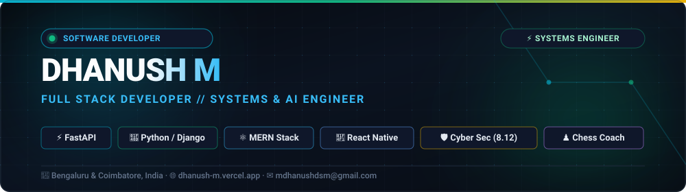

<div align="center">
  <!-- Guaranteed Self-Hosted Vector Banner (100% Uptime directly from repository) -->
  

  <br/><br/>

  <!-- Animated Real-time Typing SVG -->
  <a href="https://dhanush-m.vercel.app/">
    
  </a>
</div>

<p align="center">
  <a href="https://dhanush-m.vercel.app/"></a>
  <a href="https://www.linkedin.com/in/dhanushm13/"></a>
  <a href="mailto:mdhanushdsm@gmail.com"></a>
  <a href="tel:+919566960500"></a>
  <a href="https://komarev.com/ghpvc/?username=dhanushmsr&color=06b6d4&style=for-the-badge&label=PROFILE+VIEWS"></a>
</p>

---

## ⚡ Quick Dossier

```yaml
Engineer:       Dhanush M
Current Role:   Software Developer @ Harvee Technologies (Bengaluru, India)
Education:      B.E. Computer Science & Engineering (Honours in Cyber Security)
                Hindusthan Institute of Technology · CGPA: 8.12
Certifications: Certified in DSA & Flask by HCL GUVI
Philosophy:     "There's no magic in code. Just logic, and the patience to follow it through."
Key Projects:   FastX Multi-Vendor Marketplace, GoSouthIndia AI, Ganesha Restaurant POS
Passions:       Competitive Chess Player & Tactical Coach, Open Source Distributed Systems
```

---

## 🚀 Pinned Production Repositories

<div align="center">
  <!-- FastX Hyperlocal Delivery Multi-Vendor Marketplace -->
  <a href="https://github.com/dhanushmsr/Hyperlocal-Delivery-Multi-Vendor-Marketplace">
    
  </a>
  <!-- GoSouthIndia Tour Guide AI -->
  <a href="https://github.com/dhanushmsr/Tour-Guide-With-LLM-and-Voice-based-guide">
    
  </a>
</div>

---

## 🐍 GitHub Contribution Snake (Automated via GitHub Actions)

<!-- This animated retro arcade snake eats your GitHub contribution commits daily via GitHub Action! -->
<div align="center">
  <picture>
    <source media="(prefers-color-scheme: dark)" srcset="https://raw.githubusercontent.com/dhanushmsr/dhanushmsr/output/github-contribution-grid-snake-dark.svg">
    <source media="(prefers-color-scheme: light)" srcset="https://raw.githubusercontent.com/dhanushmsr/dhanushmsr/output/github-contribution-grid-snake.svg">
    
  </picture>
</div>

---

## 📊 Live GitHub Analytics & Telemetry

<div align="center">
  <a href="https://github.com/dhanushmsr">
    
  </a>
  <a href="https://github.com/dhanushmsr">
    
  </a>
</div>

<br/>

<div align="center">
  <a href="https://github.com/dhanushmsr">
    
  </a>
</div>

---

## 🛠️ Engineering Competencies & Tooling

### 💻 Languages
<p align="left">
  
  
  
  
  
  
  
</p>

### ⚙️ Backend, Microservices & Architecture
<p align="left">
  
  
  
  
  
  
  
  
</p>

### 📱 Frontend & Mobile Development
<p align="left">
  
  
  
  
  
  
</p>

### 🗄️ Databases & Storage
<p align="left">
  
  
  
  
  
</p>

### ☁️ Cloud, DevOps & Systems
<p align="left">
  
  
  
  
  
  
  
  
</p>

---

## 🚀 Featured Engineering Projects

| Project | Highlights & Capabilities | Stack & Architecture | Code / Access |
| :--- | :--- | :--- | :---: |
| **FastX** | **Hyperlocal Quick-Commerce & Multi-Vendor Grocery Marketplace** — 10-minute delivery ecosystem synchronizing multi-merchant catalogs, dynamic wallet transactions, coupon validation engine, and live delivery dispatch. | `Python` `Django` `REST APIs` `MySQL` `Geo-Routing` `FastX Wallet` | [Repository](https://github.com/dhanushmsr/Hyperlocal-Delivery-Multi-Vendor-Marketplace) |
| **GoSouthIndia** | **AI Cultural Tourism & Digital Concierge Platform** — Real-time heritage insights covering UNESCO monuments with Gemini LLM, domain-grounded RAG pipeline, and Edge-TTS multilingual speech reading. | `FastAPI` `Python` `Gemini LLM` `RAG` `Edge-TTS` `RBAC` `PostgreSQL` | [Repository](https://github.com/dhanushmsr/Tour-Guide-With-LLM-and-Voice-based-guide) |
| **Ganesha Restaurant (OmniServe)** | **Full-Stack Restaurant POS & Online Ordering Platform** — Google Maps geofenced radius limitation, delivery fee calculations, and live kitchen audio workflow via AJAX polling. | `Python` `Django` `MySQL` `Google Maps Matrix API` `AJAX` `POS` | [Repository](https://github.com/dhanushmsr/global-food-ecommerce-django) |
| **RxDx** | **Medical E-Learning & CME Platform** — Accredited education portal serving 200+ doctors with video lectures, quiz assessments, and automated certificate generation. | `React.js` `React Native` `Node.js` `Express.js` `MongoDB` `JWT` | Production |
| **ZureSmile** | **Dental Practice & Clinic Management Portal** — Handling 1,000+ monthly appointments with double-booking prevention and automated webhook notifications. | `React.js` `Node.js` `Express.js` `MongoDB` `Calendar API` | Production |
| **AcD Academy Management** | **Sports Coaching & Student Mobile App** — Batch management, attendance marking, platform fee receipts, and tournament expense logging. | `React Native` `Flutter` `Node.js` `REST APIs` | [Live App](https://acdmanage.vercel.app/#/login) |
| **Class Vision** | **AI Face Recognition Attendance System** — Automated facial recognition attendance logging platform using Haar Cascades, CSV time-logging, and Tkinter GUI. | `Python` `OpenCV` `Haar Cascades` `Tkinter` | [Repository](https://github.com/dhanushmsr/Attendance-Monitoring-System) |

---

## 🎖️ Engineering Credentials & Milestones

<p align="center">
  
  
  
  
</p>

---

## 📬 Let's Connect & Collaborate!

<p align="center">
  <a href="https://dhanush-m.vercel.app/"></a>
  <a href="https://www.linkedin.com/in/dhanushm13/"></a>
  <a href="mailto:mdhanushdsm@gmail.com"></a>
  <a href="tel:+919566960500"></a>
</p>

<div align="center">
  <sub>Engineered with precision by <strong>Dhanush M</strong> · Bengaluru &amp; Coimbatore, India</sub>
</div>
